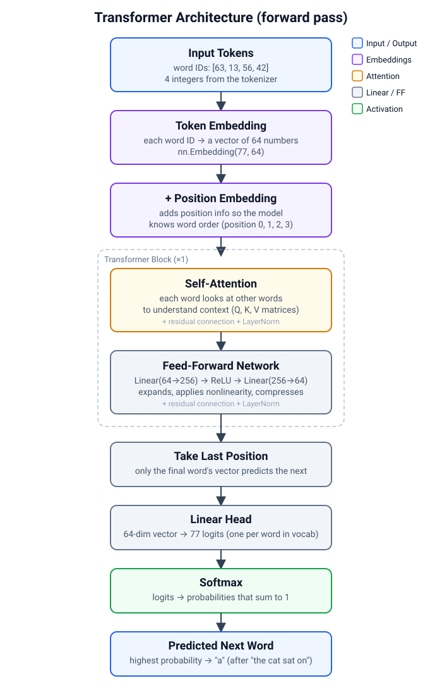
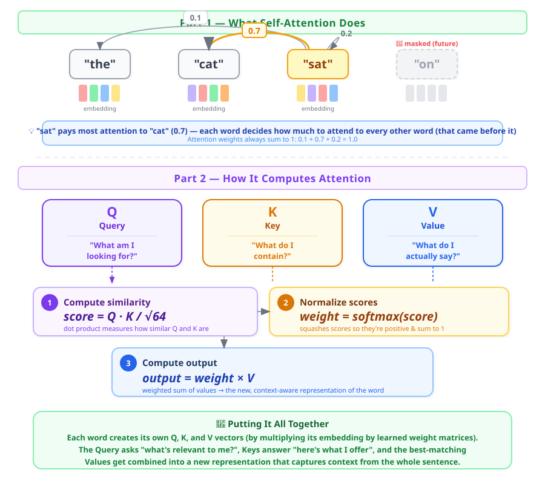
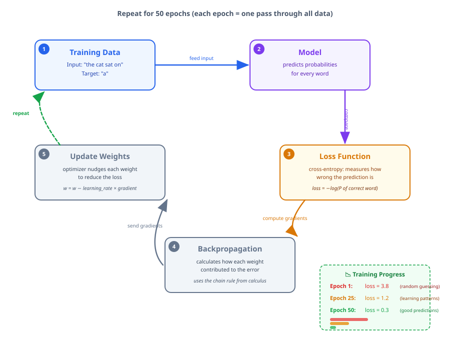

# Build an LLM from scratch

Build a tiny language model step by step in Python to understand how large language models like GPT work. Each script is self-contained and runnable, building on the previous one.

## What a language model does

A language model predicts the next word. Give it "the cat sat on" and it outputs a probability for every word in its vocabulary — "a" might get 40%, "the" might get 15%, and so on. Generation just means doing this repeatedly: predict a word, add it to the context, predict another.

## How it works

The model is a **Transformer**, the same architecture behind GPT, Claude, and Gemini. Ours is tiny (about 25,000 parameters vs. billions in real models), but every piece is the same.



| Step | What happens | Where |
|------|-------------|-------|
| Tokenize | Split text into words, map each to a number | `01_tokenizer.py` |
| Embed | Look up a 64-number vector for each word | `03_model.py` → `token_emb` |
| Add position | Add another vector so the model knows word order | `03_model.py` → `pos_emb` |
| Self-attention | Each word looks at the other words to understand context | `03_model.py` → `attention` |
| Feed-forward | Two linear layers refine each position's representation | `03_model.py` → `ff` |
| Predict | Project the final vector to vocabulary-size logits, then softmax | `03_model.py` → `head` |

## The maths, explained

You need basic algebra and the intuition behind vectors. No calculus is required to _understand_ the model, though training uses it behind the scenes.

### Embeddings: words as vectors

Each word becomes a list of 64 numbers (a vector). Words with similar meanings end up with similar vectors. Think of it as coordinates in a 64-dimensional space — "cat" and "dog" are close together, "cat" and "castle" are far apart.

```
"cat"    → [0.12, -0.45, 0.78, ..., 0.33]   (64 numbers)
"dog"    → [0.15, -0.41, 0.80, ..., 0.30]   (close to "cat")
"castle" → [-0.82, 0.61, -0.23, ..., 0.95]  (far from "cat")
```

### Positional encoding: adding word order

The model processes all words at once (not one by one like an RNN), so it doesn't naturally know which word is first or last. We add a position vector to each word's embedding:

```
final_vector = word_vector + position_vector
```

Position 0 always gets the same vector, position 1 always gets the same vector, and so on. The model learns these position vectors during training.

### Self-attention: words talking to each other

This is the key innovation of the Transformer. Each word creates three vectors from its embedding:

- **Query (Q):** "What am I looking for?"
- **Key (K):** "What do I contain?"
- **Value (V):** "What information should I pass along?"



The attention score between word _i_ and word _j_ is:

$$\text{score}(i, j) = \frac{Q_i \cdot K_j}{\sqrt{d}}$$

where $Q_i \cdot K_j$ is the dot product (multiply element-wise, then sum — higher means more similar) and $\sqrt{d}$ is a scaling factor ($\sqrt{64} = 8$ in our model) that keeps the numbers from getting too large.

Then softmax turns the scores into weights that sum to 1:

$$\text{weight}(i, j) = \frac{e^{\text{score}(i,j)}}{\sum_k e^{\text{score}(i,k)}}$$

The output for word _i_ is the weighted sum of all Value vectors:

$$\text{output}_i = \sum_j \text{weight}(i, j) \times V_j$$

**Causal masking:** The model can only look at words that came _before_ the current position. In "the cat sat on", when processing "sat", it can see "the" and "cat" but not "on". This prevents cheating during training.

### Feed-forward network

After attention, each position goes through two linear layers with a ReLU activation in between:

$$\text{FFN}(x) = \text{ReLU}(x \cdot W_1 + b_1) \cdot W_2 + b_2$$

ReLU is simple: `ReLU(x) = max(0, x)`. It zeroes out negative values. The first layer expands the 64 dimensions to 256, the second compresses back to 64. This gives the model capacity to learn complex patterns.

### Residual connections and layer norm

Around both the attention and feed-forward layers, we add the input back to the output (a "residual connection"):

$$\text{output} = \text{LayerNorm}(x + \text{Sublayer}(x))$$

This helps gradients flow during training (without it, deep networks are hard to train). Layer normalization keeps the numbers in a reasonable range.

## Training



Training means adjusting the model's weights so it gets better at predicting the next word:

1. **Forward pass:** Feed a context ("the cat sat on") through the model → get probabilities.
2. **Loss:** Cross-entropy measures how far off the prediction is from the correct answer ("a"):

   $$\text{loss} = -\log(p_{\text{correct}})$$

   If the model gives the correct word a probability of 0.9, the loss is $-\log(0.9) = 0.105$ (low, good). If it gives 0.01, the loss is $-\log(0.01) = 4.6$ (high, bad).

3. **Backpropagation:** The chain rule from calculus computes how much each weight contributed to the loss. PyTorch does this automatically with `loss.backward()`.

4. **Update:** The optimizer (Adam) nudges each weight in the direction that reduces the loss:

   $$w_{\text{new}} = w_{\text{old}} - \eta \times \nabla_w \text{loss}$$

   where $\eta$ (eta) is the learning rate (0.003 in our case).

## Setup

You need [uv](https://docs.astral.sh/uv/). No GPU required — the model is small enough to train on a CPU in a few seconds.

```bash
cd model-building/llm
```

## Run it

Run the scripts in order. Each one builds on the outputs of the previous ones.

```bash
# Step 1: Build the vocabulary and tokenize the text
uv run python 01_tokenizer.py

# Step 2: See the training examples (context → next word)
uv run python 02_dataset.py

# Step 3: Inspect the model architecture and parameter count
uv run python 03_model.py

# Step 4: Train the model (about 5 seconds on CPU)
uv run python 04_train.py

# Step 5: Generate text from prompts
uv run python 05_generate.py

# Step 6: Plot the training loss and attention weights
uv run python 06_visualize.py
```

### Expected output from step 1:

```
Text has 299 words
Vocabulary size: 77 unique words

Sample word → number mappings:
  'the' → 63
  'cat' → 13
  'sat' → 56
  'on'  → 42
  'a'   → 0

Tokenize:   'the cat sat on a mat'
  → numbers: [63, 13, 56, 42, 0, 40]
  → back:    'the cat sat on a mat'
```

### Expected output from step 5:

```
Generated text (temperature=0.8):

  Prompt: 'once upon a time'
  Output: once upon a time there was a cat the cat sat on a mat the cat saw a rat the rat

  Prompt: 'the cat sat on'
  Output: the cat sat on a mat the cat saw a rat the rat ran away

  Prompt: 'the dog played in'
  Output: the dog played in the park the dog chased a ball the ball rolled away
```

## Learn by experimenting

### 1. Change the context length

In `03_model.py`, try `context_length=2` instead of 4. The model sees fewer words, so it has less context to work with. Retrain and compare the generated text.

### 2. Change the embedding dimension

Try `embed_dim=16` (smaller) or `embed_dim=128` (larger). Smaller embeddings train faster but capture less. With our tiny dataset, 64 is more than enough.

### 3. Add more training data

Write more sentences in `data/tiny-stories.txt`. The model can only generate words it has seen, so adding new words expands its vocabulary.

### 4. Change the temperature

In `05_generate.py`, try temperature values from 0.1 (very deterministic, always picks the most likely word) to 2.0 (very random). Watch how the output changes.

### 5. Remove the causal mask

In `03_model.py`, set `attn_mask=None` in the attention call. Now the model can see future words during training, which is cheating. Compare the loss curve and the generated text.

## What makes real LLMs different

| This project | Real LLMs (GPT-4, Gemini, etc.) |
|-------------|--------------------------------|
| 77 words in vocabulary | 50,000–100,000 subword tokens (BPE) |
| 64-dimensional embeddings | 4,096–12,288 dimensions |
| 1 Transformer block | 32–120 blocks stacked |
| 4 attention heads | 32–96 heads |
| ~60,000 parameters | 7 billion–1.8 trillion parameters |
| 15 tiny sentences | Trillions of words from the internet |
| Trains in 5 seconds on CPU | Trains for weeks on thousands of GPUs |
| Word-level tokenizer | BPE/SentencePiece subword tokenizer |

The architecture is identical. The scale is the only difference.

## Further reading

- [Attention Is All You Need](https://arxiv.org/abs/1706.03762) — the original Transformer paper (Vaswani et al., 2017)
- [The Illustrated Transformer](https://jalammar.github.io/illustrated-transformer/) — visual walkthrough by Jay Alammar
- [GPT in 60 Lines of NumPy](https://jaykmody.com/blog/gpt-from-scratch/) — similar project without PyTorch
- [Let's build GPT](https://www.youtube.com/watch?v=kCc8FmEb1nY) — Andrej Karpathy's video walkthrough
- [nanoGPT](https://github.com/karpathy/nanoGPT) — a clean, small GPT implementation for training on real data

## Glossary

| Term | Meaning |
|------|---------|
| **Token** | A word (or subword) represented as an integer |
| **Embedding** | A fixed-length vector of numbers representing a token |
| **Self-attention** | Mechanism that lets each token look at other tokens to understand context |
| **Causal mask** | Prevents the model from seeing future tokens during training |
| **Softmax** | Turns a list of numbers into probabilities that sum to 1 |
| **Cross-entropy loss** | Measures how far the predicted probabilities are from the correct answer |
| **Backpropagation** | Algorithm that computes how much each weight contributed to the error |
| **Gradient** | The direction and magnitude of change needed to reduce the loss |
| **Learning rate** | How big a step the optimizer takes when updating weights |
| **Epoch** | One complete pass through all the training data |
| **Logits** | Raw scores before softmax — one per word in the vocabulary |
| **Residual connection** | Adding the input to the output of a layer, so information can skip layers |
| **Layer normalization** | Rescales values to have mean 0 and variance 1, stabilizing training |
